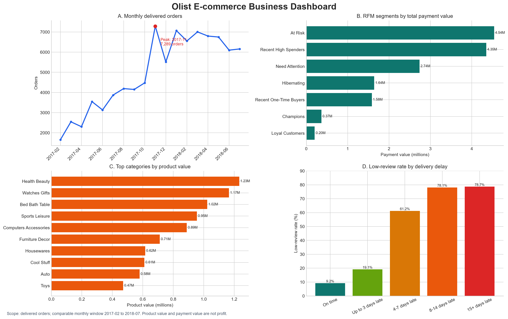

# Olist 电商经营分析

基于巴西 Olist 公开电商数据构建的 SQL 数据分析作品集项目。项目从原始 CSV 建立 SQLite 数据库，完成数据质量审计、订单级指标层、月度经营趋势、客户复购与 RFM、商品与卖家结构、履约质量与评价分析，并通过 Python 生成可复现的管理仪表盘。



## 项目目标

本项目围绕四类经营问题展开：

1. **经营趋势**：订单量、客户支付金额和客单价如何随月份变化？
2. **客户运营**：复购规模、购买间隔、同期群留存和 RFM 客群有什么特征？
3. **商品与供给**：哪些品类贡献主要销售额，平台是否依赖少数卖家？
4. **履约体验**：配送延迟是否与低评分同时出现，控制订单结构后关系是否仍存在？

## 关键发现

- 在严格可比月份中，2017-11 的已送达订单达到峰值 7,289 笔，环比增长 62.77%；2017-12 随后下降 24.37%。缺少活动与流量数据，不能将峰值直接归因于促销。
- 93,358 名已送达客户中，2,801 人拥有至少两笔已送达订单，历史窗口复购客户比例为 3.00%。
- RFM 分层显示，`At Risk` 客群累计支付金额最高，约为 454 万，同时平均约 395 天未购买，适合优先测试召回策略。
- `health_beauty` 商品销售额最高，占全部已送达商品销售额的 9.33%；销量、平均售价与销售额排名并不完全一致。
- 2,970 位有效卖家中，第一名仅贡献 1.72% 的商品销售额；但约 4.28% 的卖家贡献 50%，说明平台不依赖单个卖家，同时存在头部集中。
- 可比较的已送达订单延迟率为 8.11%。延迟订单低评分率为 53.99%，准时订单为 9.19%。延迟进入 4–7 天后，低评分率明显跃升。
- 在单商品、多商品单卖家和多卖家订单内部，延迟组的低评分率均更高；该结果属于相关关系，不能直接解释为因果。

## 分析方法

- 审计 9 张原始表的粒度、候选键、缺失值和生命周期时间；
- 将商品、支付和评价明细分别聚合到订单粒度，避免多对多连接造成金额膨胀；
- 使用 CTE、条件聚合、窗口函数、`LAG`、`PERCENT_RANK` 和同期群矩阵；
- 使用 `customer_unique_id` 识别跨订单的现实客户；
- 对月份覆盖、评价缺失、商品品类翻译缺失和小样本分组保留解释边界；
- 在履约评价分析中按订单结构分层，减少订单复杂程度的干扰。

## 数据来源与口径

- 数据集：[Brazilian E-Commerce Public Dataset by Olist](https://www.kaggle.com/datasets/olistbr/brazilian-ecommerce)
- 范围：约 10 万笔订单，覆盖订单、客户、商品、卖家、支付、评价和地理位置；
- 月度趋势严格可比窗口：2017-02 至 2018-07；
- 核心经营分析通常限定 `order_status = 'delivered'`；
- 商品销售额、客户支付金额和利润是不同概念；数据缺少完整成本、平台费用、营销费用和退款信息，因此不计算利润。

原始 CSV 和生成的 SQLite 数据库体积较大，不纳入 Git。项目保留数据库构建脚本、完整 SQL、结果表和图表生成脚本。

## 项目结构

```text
olist-ecommerce-analytics/
├── data/
│   ├── raw/                    # Kaggle 原始 CSV（不提交 Git）
│   └── processed/              # 本地 SQLite 数据库（不提交 Git）
├── docs/
│   ├── business_and_data_overview.md
│   ├── data_dictionary.md
│   ├── monthly_kpi_findings.md
│   ├── customer_analysis_findings.md
│   ├── product_seller_findings.md
│   └── delivery_review_findings.md
├── outputs/
│   ├── figures/                # 可复现仪表盘
│   └── tables/                 # 仪表盘底层结果表
├── scripts/
│   ├── build_database.py       # CSV 转 SQLite
│   ├── run_query.py            # 执行单个 SQL 文件
│   └── create_portfolio_dashboard.py
├── sql/                        # 00–25：审计、指标和专题分析
├── requirements.txt
└── README.md
```

## 复现方式

在 Windows PowerShell 中进入项目根目录：

```powershell
python -m venv .venv
.\.venv\Scripts\Activate.ps1
python -m pip install -r requirements.txt
```

将 Olist 的 9 个原始 CSV 放入 `data/raw/`，然后执行：

```powershell
python scripts/build_database.py
python scripts/run_query.py sql/24_delivery_review_relationship.sql
python scripts/create_portfolio_dashboard.py
```

生成的数据库位于 `data/processed/olist.db`，仪表盘位于 `outputs/figures/olist_business_dashboard.png`。

## 详细分析报告

- [月度经营指标与趋势](docs/monthly_kpi_findings.md)
- [客户复购、留存与 RFM 分层](docs/customer_analysis_findings.md)
- [商品品类与卖家结构](docs/product_seller_findings.md)
- [履约质量与客户评价](docs/delivery_review_findings.md)

## 分析边界

- 数据是历史观察数据，无法单独识别营销活动或履约变化的因果效果；
- 数据集起止日期之外的购买不可见，早期客户分析存在左截断；
- 月度末尾不完整月份不用于严格趋势比较；
- 订单状态与时间字段存在少量冲突，分析保留审计记录，不在缺少证据时直接删除；
- 分组样本较小时，比例可能剧烈波动，报告会明确标注样本量。
